
<a href="README.md">English</a> · <a href="README.ru.md">Русский</a>

<h1 align="center">Automotive Showroom</h1>

A cinematic vehicle showcase with discovery, comparison and a guided purchase journey.

    

A public showcase of a private project, presenting anonymized interfaces and key workflows. Source code and internal project materials remain private.

## Key workflows

- Discover and filter vehicles
- Explore details, views and comparisons
- Follow the purchase journey to a contact form

## Gallery

Screens are presented individually with their proportions preserved. Identifying branding, contacts and data are replaced with demo content. These previews illustrate the product and do not imply a live service is available.

Some images were anonymized with AI.

### Interface overview

<a href="images/01-preview.png">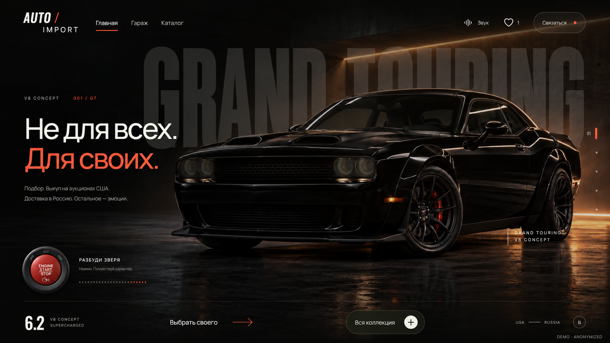</a>

### Showroom

<a href="images/02-showroom-light.png">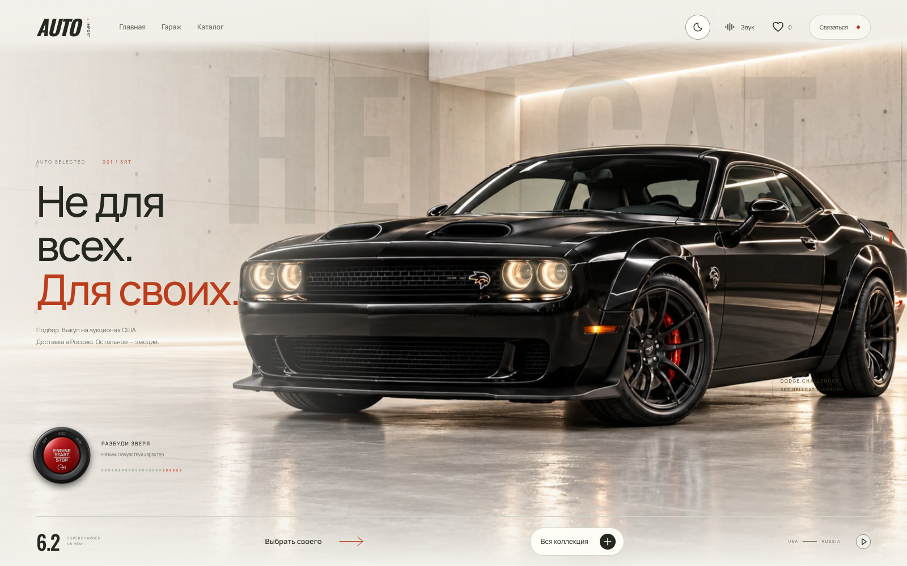</a>

### Discovery

<a href="images/03-showroom-discovery.png">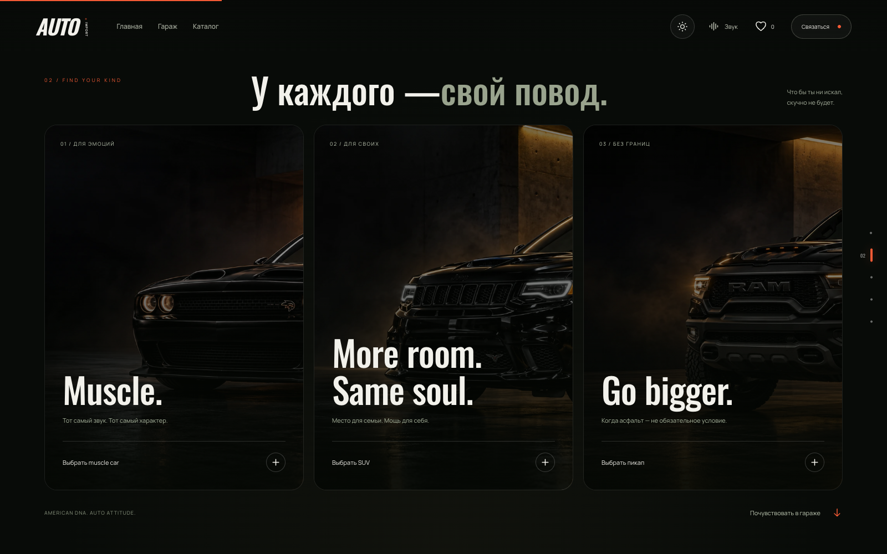</a>

### Vehicle collection

<a href="images/04-showroom-garage.png">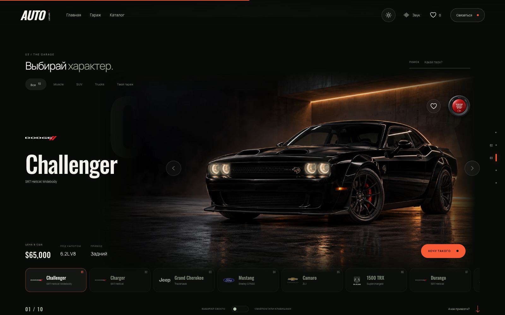</a>

### Catalog

<a href="images/05-showroom-catalog.png">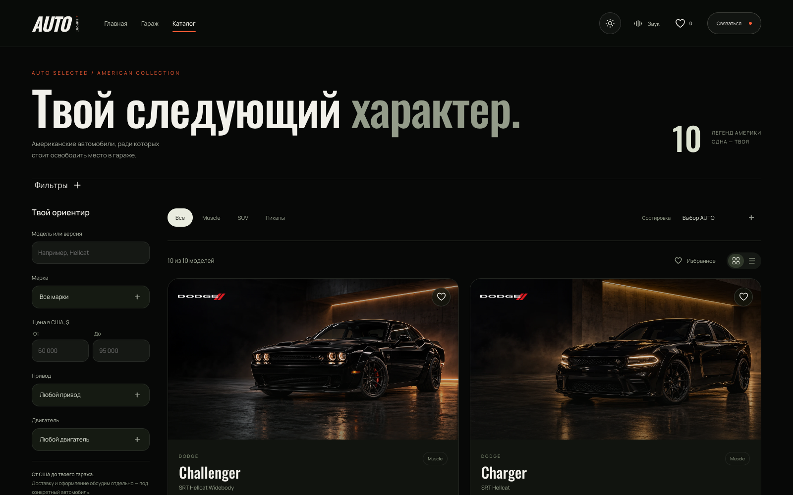</a>

### Vehicle details

<a href="images/06-showroom-detail.png">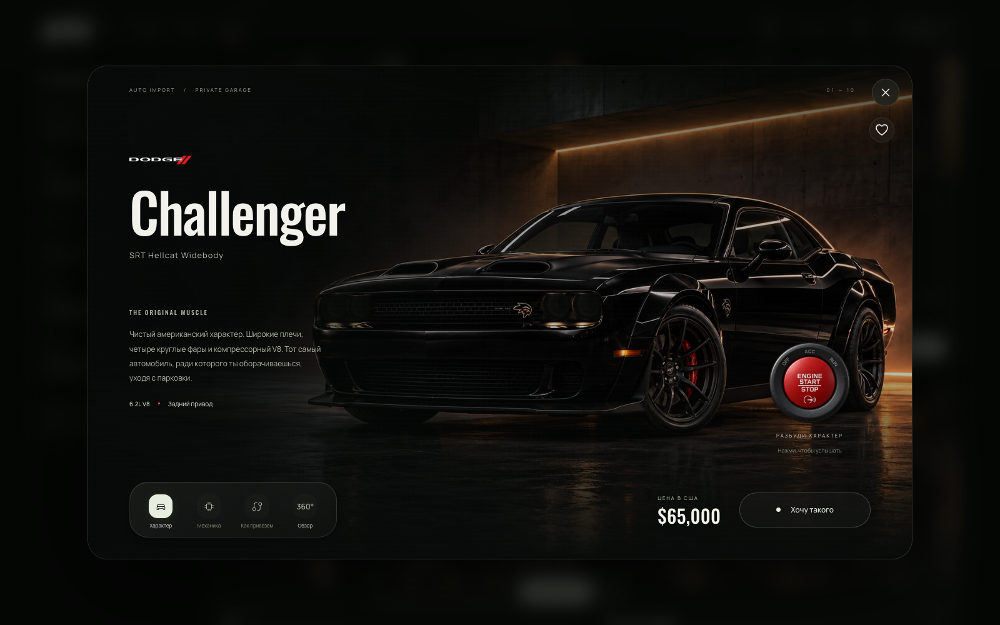</a>

### Vehicle views

<a href="images/07-showroom-rotation.png">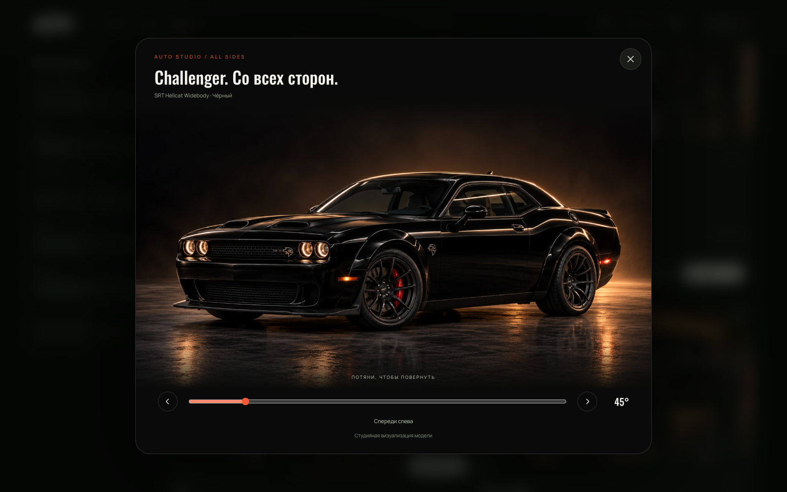</a>

### Comparison

<a href="images/08-showroom-compare.png">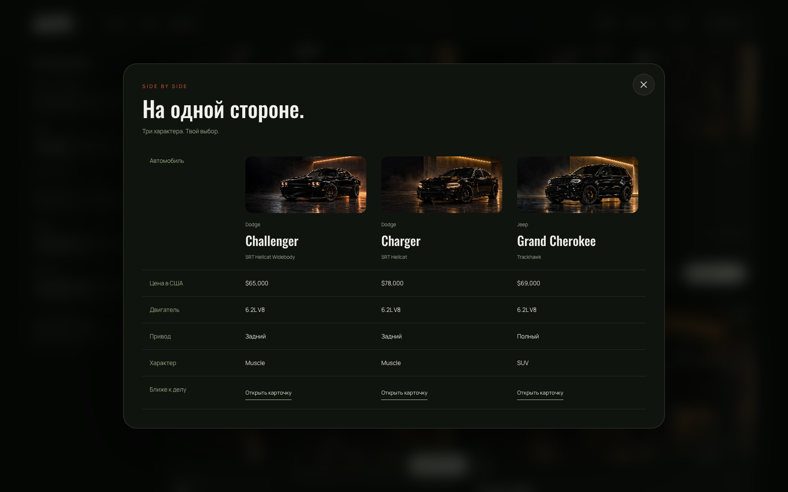</a>

### Purchase journey

<a href="images/09-showroom-journey.png">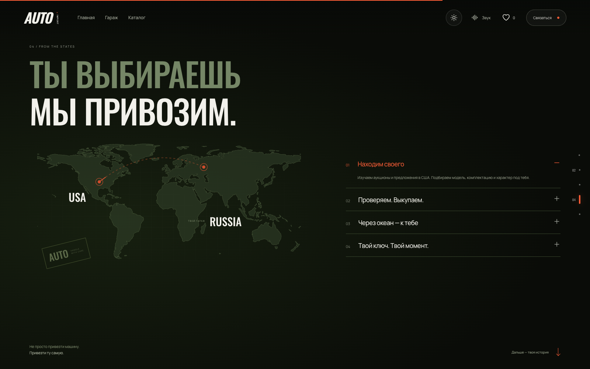</a>

### Contact form

<a href="images/10-showroom-contact.png">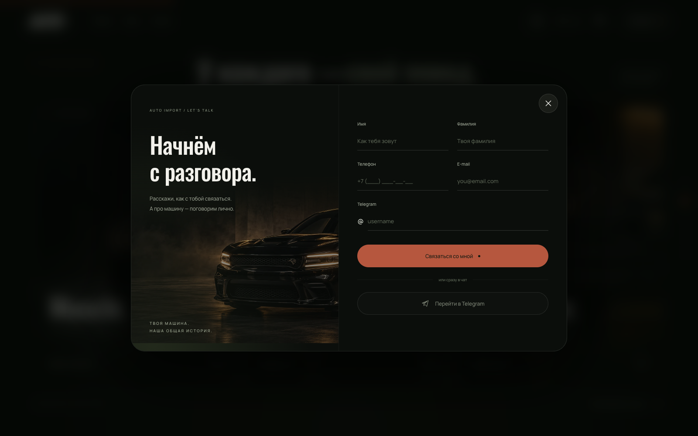</a>

### Mobile overview

<a href="images/11-showroom-mobile-home.png">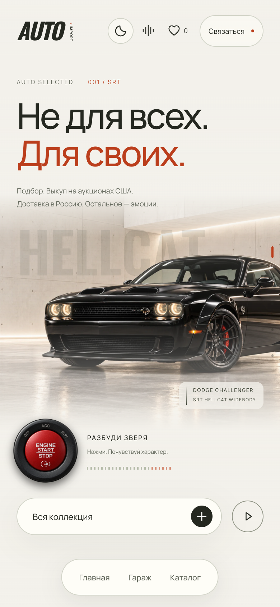</a>

### Mobile catalog

<a href="images/12-showroom-mobile-catalog.png">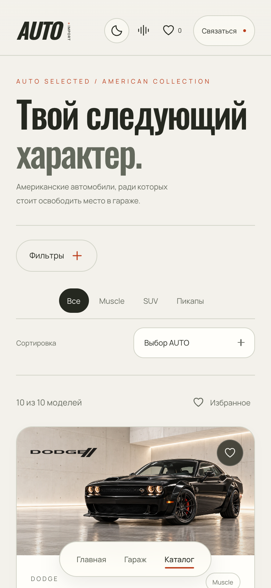</a>

---

[Explore all projects](https://github.com/svllvsx)
